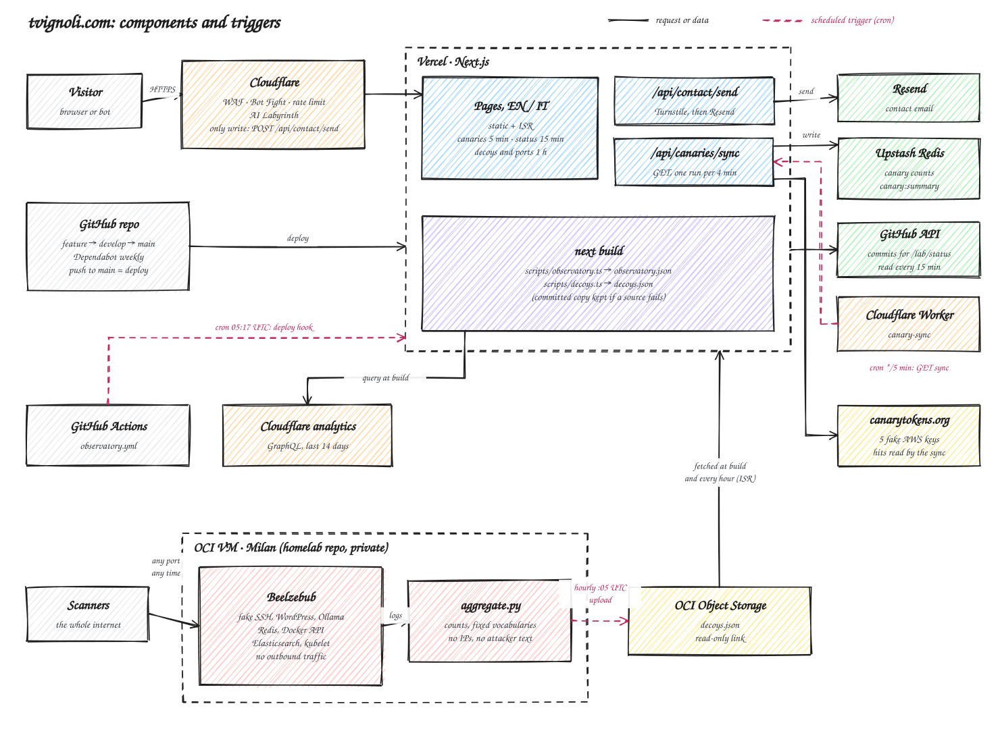

# tvignoli.com

My personal site: articles, work, CV, and a **Lab** where I publish what the internet throws at this site and at a few decoy servers I run on purpose.

Next.js 16 (App Router) on Vercel, behind Cloudflare. TypeScript, Tailwind v4, Bun. Every page exists in English and Italian.



## Pages

All routes live under `/en` and `/it`.

| Route | What it shows | Data |
|---|---|---|
| `/` | Latest writing, selected work, experience, contact | `src/data/content/` |
| `/articles`, `/articles/[slug]` | Articles, filterable by tag | `src/data/content/articles.ts` |
| `/portfolio` | Projects with figures | `src/data/content/projects.ts` |
| `/experience`, `/cv` | The same data; `/cv` prints to PDF | `src/data/content/` |
| `/lab` | **Observatory**: what reaches this site, aggregated by day, plus case studies | `observatory.json`, rebuilt daily |
| `/lab/decoys/canaries`, `…/[channel]` | Five fake AWS keys left in places where real keys leak, and how long each took to be used | canarytokens.org via Upstash, every 5 min |
| `/lab/decoys/ports`, `…/[port]` | Fake Redis, Docker API, Elasticsearch and kubelet opened one at a time, with a stopwatch | `decoys.json`, hourly |
| `/lab/decoys/ai` | A fake Ollama endpoint and who tries to use it | `decoys.json`, hourly |
| `/lab/passwords` | Check a password against the ones attackers tried (in the browser, nothing is sent) | `decoys.json`, hourly |
| `/lab/compare` | Behind Cloudflare vs. a bare server | `observatory.json` + `decoys.json` |
| `/lab/status` | The site checking itself: last deploy, commit, how fresh each data source is | GitHub API, every 15 min |

Also: `/[locale]/feed.xml` (RSS), `/llms.txt`, `/og-image.png`, `robots.txt`, `sitemap.xml`. The old `/dashboard`, `/live` and `/shell` redirect to `/lab`.

## How the Lab gets its data

Three sources, each with its own schedule. None of them sends IP addresses, locations or the text an attacker typed to the site: only counts, times and labels from fixed lists.

**Observatory.** `scripts/observatory.ts` runs before every `next build`. It asks Cloudflare's GraphQL analytics for the last 14 days and reduces paths and user agents to labels (`src/lib/observatory/classify.ts`) before writing `src/data/observatory.json`. A GitHub Action (`.github/workflows/observatory.yml`) calls a Vercel deploy hook every day at 05:17 UTC, so the data is never more than a day old.

**Decoys.** A small VM on Oracle Cloud runs [Beelzebub](https://github.com/mariocandela/beelzebub) with fake services on their usual ports, with outbound traffic blocked. Every hour at :05 UTC a script on the VM turns the logs into `decoys.json` and uploads it to a bucket. The site reads it through a read-only link (`DECOYS_URL`) at build time and again at most every hour. The VM's configuration lives in a separate private repository. The file comes from a machine built to be attacked, so `src/lib/decoys.ts` treats it as untrusted input: it rebuilds it field by field and rejects anything out of shape.

**Canaries.** The keys come from canarytokens.org and are never in this repository: they live in Vercel environment variables. canarytokens.org keeps only the last 50 hits per key, so a Cloudflare Worker (`scripts/canary-sync-worker.js`) calls `GET /api/canaries/sync` every 5 minutes. The sync adds what it sees to Upstash Redis and writes one summary key, which is the only thing the pages read.

## What runs when

| Trigger | What happens |
|---|---|
| A visit | Cloudflare filters it, Vercel serves a static page or regenerates it if it's stale |
| Push to `main` | Vercel production build: Observatory and decoy data are fetched first |
| Every day, 05:17 UTC | GitHub Action → Vercel deploy hook → new build |
| Every hour, :05 UTC | The decoy VM uploads a fresh `decoys.json` |
| Every 5 minutes | Cloudflare Worker → `/api/canaries/sync` → Upstash |
| Page age (ISR) | Canaries 5 min · status 15 min · decoy and port pages 1 h |
| Every week | Dependabot opens grouped update PRs on `develop` |

## Development

```bash
bun install
cp .env.example .env.local   # every variable is optional
bun run dev                  # http://localhost:9004
bun run test                 # unit tests (bun test)
bun run test:e2e             # Playwright
bun run lint
bun run typecheck
bun run observatory          # refresh Observatory data (needs the Cloudflare variables)
bun run decoys               # refresh decoy data (needs DECOYS_URL)
```

Without any variable the site still builds and runs: the Lab pages use whatever data files are on disk, the canary pages show their channels without counts, and the contact form falls back to a mailto link.

### Environment variables

| Variable | Used for |
|---|---|
| `NEXT_PUBLIC_SITE_URL` | Canonical URLs, sitemap, feeds |
| `NEXT_PUBLIC_GA_MEASUREMENT_ID`, `NEXT_PUBLIC_ANALYTICS_URL` | Analytics and Web Vitals, both optional |
| `NEXT_PUBLIC_GOOGLE_SITE_VERIFICATION` | Search Console |
| `RESEND_API_KEY`, `CONTACT_FROM_EMAIL` | Contact form; both or neither |
| `NEXT_PUBLIC_TURNSTILE_SITE_KEY`, `TURNSTILE_SECRET_KEY` | Bot check on the contact form |
| `CLOUDFLARE_ANALYTICS_TOKEN`, `CLOUDFLARE_ZONE_ID` | Observatory at build time (Analytics: Read, this zone only) |
| `DECOYS_URL` | Read-only link to `decoys.json` |
| `CANARY_EXPORTS` | `channel=token:auth` pairs to read canary hits |
| `CANARY_<CHANNEL>_ACCESS_KEY`, `CANARY_<CHANNEL>_SECRET_KEY` | Decoy keys the site itself serves (HTML comment, robots.txt channel) |
| `KV_REST_API_URL`, `KV_REST_API_TOKEN` (or `UPSTASH_REDIS_REST_*`) | Upstash Redis for canary counts |

`.env.example` has the details, including Turnstile test keys. Never pull production variables to a local file.

## Layout

```
src/app/            routes (App Router); pages under [locale]/(marketing)
src/components/     UI, Observatory charts, shared pieces
src/data/           content, translations (locales/), decoy and canary metadata
src/lib/            parsers, i18n, SEO, rate limiting, helpers (with *.test.ts beside them)
scripts/            build-time data fetchers, Cloudflare setup, canary Worker and import
tests/e2e/          Playwright
docs/               architecture diagram
```

## Security

- `scripts/cloudflare-apply-security.sh` applies the edge configuration: Bot Fight, AI Labyrinth, rate limiting, and a WAF rule that lets through only one write route (`POST /api/contact/send`). Every other POST, PUT, PATCH or DELETE gets a 403 at the edge.
- CSP and security headers are set in `src/proxy.ts`.
- External data (Cloudflare, `decoys.json`, canary exports, Upstash) is size-capped and validated before use.
- To report a problem, see [`/.well-known/security.txt`](public/.well-known/security.txt).

## Deploy

Work happens on a feature branch, which goes into `develop` through a pull request. `develop` is merged into `main` with a release PR, and every push to `main` is a Vercel production deploy.
